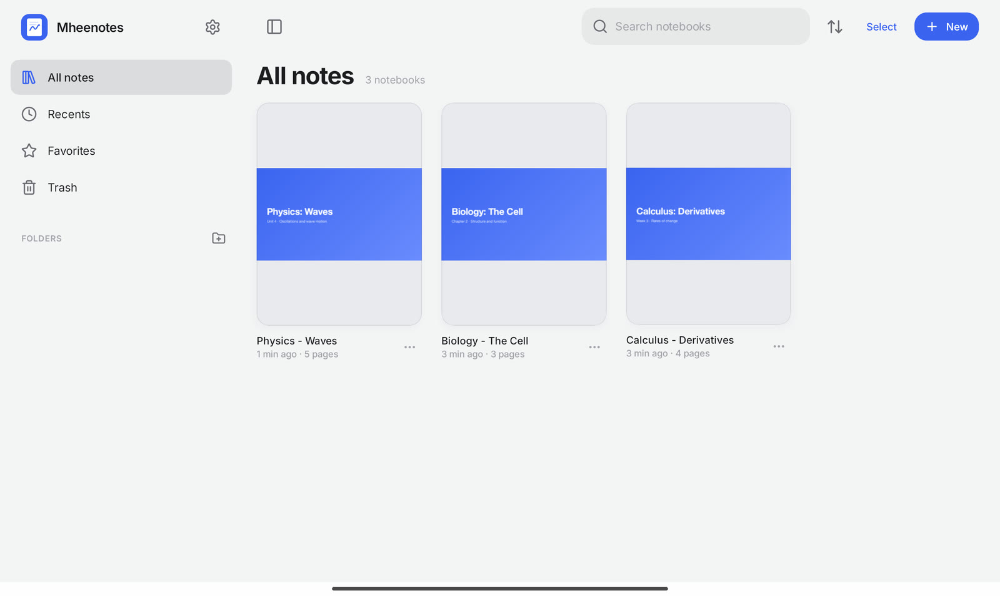
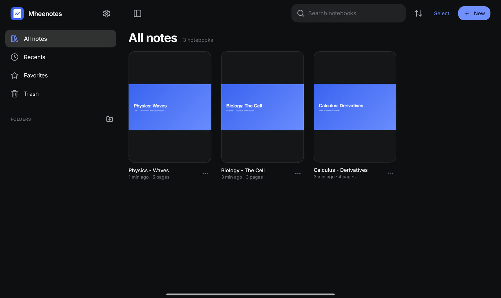
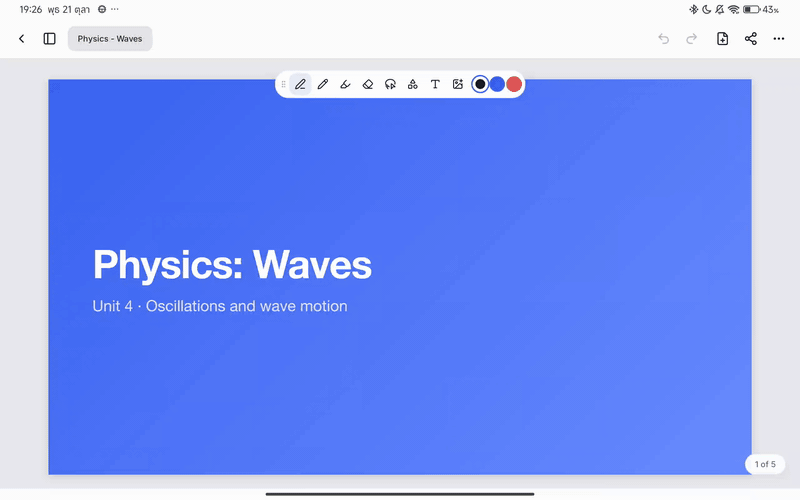
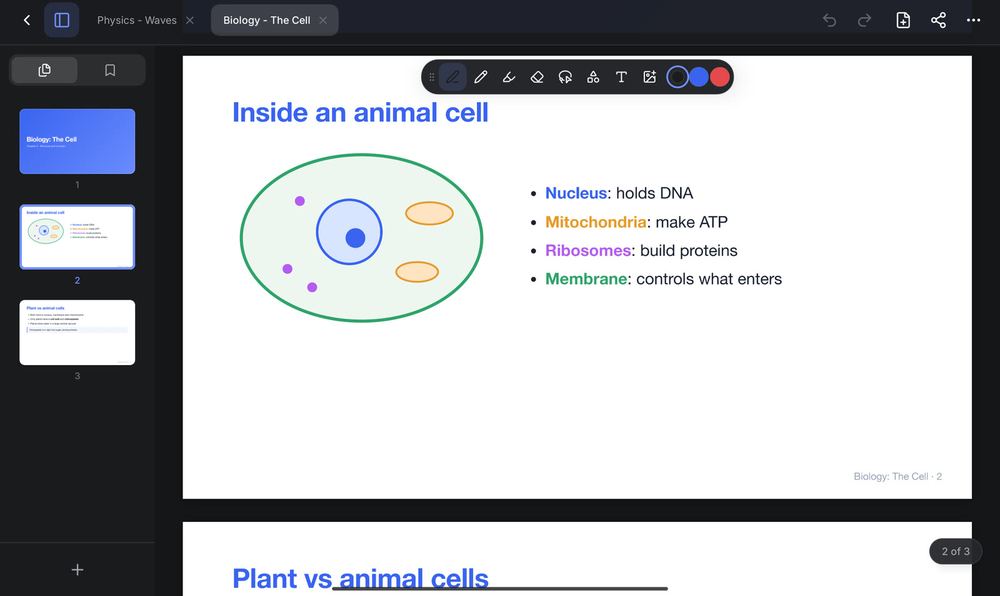
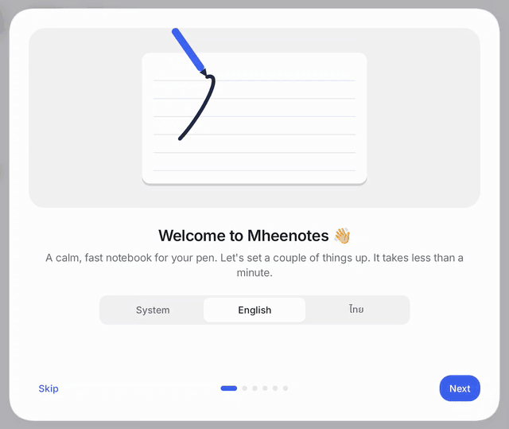
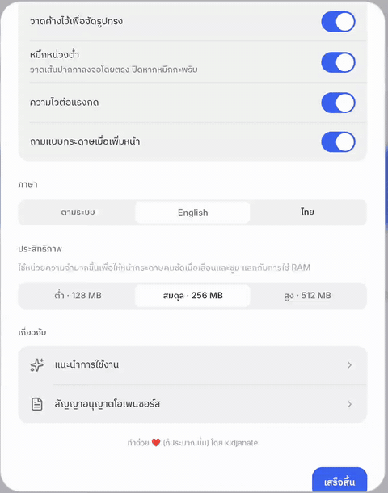

<div align="center">


# Mheenotes

**A calm, fast handwriting notebook for Android tablets.**

Write with your pen, scroll with your finger, and bring your PDFs along.
No account, no ads, no network. Your notes stay on your tablet.

[**Download the latest APK**](https://github.com/kidjanate/Mheenotes/releases/latest) · Android 10+ · English and ไทย




</div>

---

## Features

### Ink that keeps up

<!-- TODO(media): docs/media/handwriting.gif — pen writing on a lined page -->

- Pen, pencil and highlighter with pressure, custom colors and width presets
- Low-latency ink drawn straight to the display, so the line stays under the nib
- **Scribble over ink to erase it**, or use the eraser on whole strokes or just the part you touch
- **Hold at the end of a stroke to snap it** into a clean line, ellipse, triangle or rectangle; lines snap to 45° steps
- Smooth on huge pages: tens of thousands of strokes still scroll and zoom without hitches

<!-- TODO(media): docs/media/scribble-shapes.gif — scribble to erase, hold to snap a circle -->

### Lasso, text and images

<!-- TODO(media): docs/media/lasso.gif — lasso a drawing, move it, recolor it -->

- Lasso anything to move, scale, rotate, recolor, copy or delete it
- Capture a lasso area as an image, then share it, save it to Photos or paste it back in
- Text boxes with fonts, sizes, bold, italic, underline and alignment
- Images with crop and lock, selectable with a finger tap

### Bring your PDFs



- Import a PDF from the library, or **share one to Mheenotes** from any app
- Write right on the pages; insert more pages from another PDF anywhere
- **Find in PDF** on every Android version, with every match highlighted and the view centered on each
- Export back to PDF: all pages, the current page or a range like `1-3, 7`

### A library that stays out of the way



- Folders, favorites, recents, search and sorting; drag notebooks into folders
- Open several notebooks as tabs, reorder them, or open one in a new window
- Page rail with thumbnails and bookmarks; rotate, duplicate, copy or move pages
- Page templates: blank, lined, grid, dotted, Cornell and music staff, in several paper sizes
- Trash that keeps deleted notebooks for 30 days
- Home screen widgets for recent notes and your weekly ink activity

### Made to feel at home

<table>
<tr>
<td width="60%"></td>
<td width="40%"></td>
</tr>
<tr>
<td>A short animated tour on first launch, replayable from Settings.</td>
<td>English and Thai, switchable in the app without a restart.</td>
</tr>
</table>

- Light and dark themes that follow your tablet, or pick one
- Calm, custom interface with spring motion everywhere except the ink
- Gestures: two-finger tap to undo, three-finger tap to redo, pinch to zoom
- Adjustable render memory for older or busier tablets

## Install

1. Download `Mheenotes-<version>.apk` from [Releases](https://github.com/kidjanate/Mheenotes/releases).
2. Open it on your tablet and allow installing from your browser or file manager if Android asks.

Requires Android 10 or later. Built and tested on tablets; a stylus is recommended.
Updates install over the previous version and keep your notes.

## Build from source

You need JDK 17 and the Android SDK (compile SDK 37).

```bash
git clone https://github.com/kidjanate/Mheenotes.git
cd Mheenotes
./gradlew :app:installDebug     # build and install on a connected device
./gradlew :core:allTests        # run the core tests
```

Release builds are signed with the key named in `keystore.properties` (see
[`keystore.properties.example`](keystore.properties.example)). Without it they fall back to the
debug key and print a warning.

### Project layout

| Module | What lives there |
| --- | --- |
| `core` | Kotlin Multiplatform model, geometry (smoothing, shape recognition, lasso), the notebook document with undo/redo, and SQLite storage |
| `ui` | Compose Multiplatform interface: design system, library, editor, tiled page renderer, PDF tools, strings |
| `app` | The Android app shell: activities, widgets, manifest |

A few notes on how it stays fast:

- Pages are drawn as 512 px tiles per zoom level on background threads, with a whole-page preview underneath and neighbouring zoom levels as a fallback while you pinch.
- Ink in progress is drawn to a front buffer for low latency, then handed to the tiles.
- Every notebook is its own SQLite database, and items are indexed in a spatial grid.

## Contributing

Bug reports, ideas, translations and pull requests are all welcome. Please read
[CONTRIBUTING.md](CONTRIBUTING.md) before opening a pull request.

- Found a bug? [Open an issue](https://github.com/kidjanate/Mheenotes/issues/new/choose) with your tablet model and steps to reproduce.
- Want to translate Mheenotes? Copy `ui/src/commonMain/composeResources/values-th/strings.xml` to your language's folder and send a pull request.

## Privacy

Mheenotes has no account, no analytics and no network access. Notebooks, PDFs and settings are
stored only in the app's private storage on your tablet. Exports and shares only happen when you
ask for them.

## License

<!-- TODO: choose a license and add the LICENSE file before publishing. -->

Third-party libraries and fonts are listed, with their licenses, in the app under
**Settings → Open-source licenses**.
